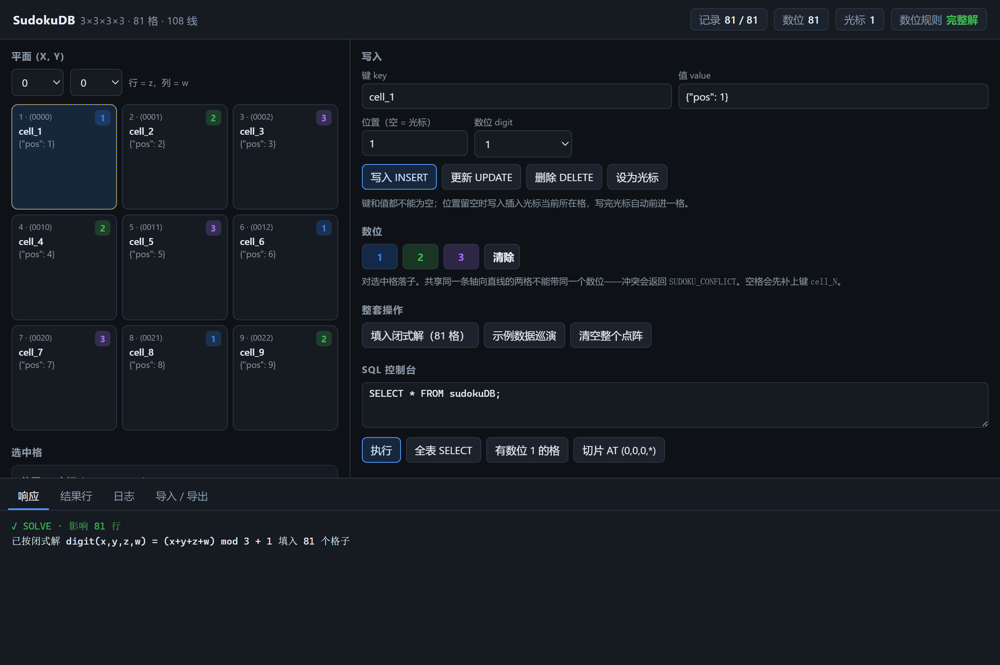

# Tesseract — 4D, 3 cells per axis by default

[](https://mooncakes.io/docs/riantr/tesseract)
[](https://github.com/riantr/tesseract/releases)
[](LICENSE)

A tiny multi-key JSON value database stored over a **4D sudoku lattice**, with a
SQL surface and sudoku digit constraints.

This is the MoonBit port of the C#/Avalonia `tesseract` project, and the C#
project itself has been lifted to the same 4D lattice. The two implementations
were run against the same 26-statement sequence and produce **identical** output —
same success flags, error codes, positions, coordinates and digits.

## Install

```sh
moon add riantr/tesseract@0.1.14
```

That is a **module** dependency, and it belongs in the consumer's `moon.mod`.
`moon add` writes it for you, so the file ends up holding:

```toml
import {
  "riantr/tesseract@0.1.14",
}
```

The library is the package `riantr/tesseract/src/tesseract`, and the **package**
import belongs in the consumer's `moon.pkg`:

```moonbit nocheck
///|
import {
  "riantr/tesseract/src/tesseract",
}
```

The two blocks look alike and are not the same thing. `moon.mod` names a
*module* and pins the version it resolved; `moon.pkg` names a *package* inside
a module and takes **no version at all**. A version in a `moon.pkg` import is
not a newer spelling — it is an import the toolchain cannot find:

```
Cannot find import 'riantr/tesseract/src/tesseract@0.1.14' in my/app/src/thing@0.1.0
```

The `src/` in the package path is part of the package's name, not a prefix the
toolchain strips. A module's **library** packages live under `src/` and its
**executables** under `cmd/`, and the registry lists them under exactly those
paths — so `riantr/tesseract/src/tesseract_memory` is a package and
`riantr/tesseract/tesseract_memory` is not found. The way to write less is the
alias, below.

For the same reason there is no `@latest`: the version is parsed as semver, so
`latest`, `^0.1.14`, `>=0.1.14`, `0.1` and `v0.1.14` are all rejected. A bare
`moon add riantr/tesseract` resolves the newest release and pins the concrete
version it found — that is the "latest" this toolchain has.

The package can be given a shorter name, which is the closest thing here to
Python's `from x import y as z`:

```moonbit nocheck
///|
import {
  "riantr/tesseract/src/tesseract_memory" @tm,
}
```

so that the call is `@tm.new_memory(100)`. The alias belongs to the
**package**, not to a file: every file in that package sees it, and an import
statement inside a `.mbt` file is rejected outright — *"Invalid import
declaration here. Move this declaration to `moon.pkg`."* There is also no
re-export: `use` is a reserved word, so a package cannot hand another
package's symbols on under a name of its own.

`cmd/main`, `cmd/persist`, `cmd/memory`, `cmd/memory_db`, `cmd/sa` and `cmd/gui`
are the six executables in the same module — the command line, the file-backed
store, the short-term memory, the durable memory, the scan database and the
window. Registry entry:
[mooncakes.io/docs/riantr/tesseract@0.1.14](https://mooncakes.io/docs/riantr/tesseract@0.1.14).

### What the release was checked on

`moon 0.1.20261016` — the toolchain the release workflow installs, and the one
every number in this file was measured on. That is the toolchain this release
was **verified** against, not a tested **minimum**: no older toolchain has been
exercised here, and quoting a lower bound nobody ran would be a claim, not a fact.

### What changed in 0.1.14

**One breaking change**, and it is in the published surface:

- **`Lattice`, `Entry` and `Hit` are opaque.** Their fields are private now, and
  each field has an accessor: `Lattice::side()`, `Lattice::total()`,
  `Lattice::first_position()`, `Lattice::last_position()`, `Lattice::max_digit()`;
  `Entry::scope()`, `Entry::key()`, `Entry::value()`, `Entry::added_at()`,
  `Entry::deadline()`, `Entry::window_ms()`, `Entry::sliding()`,
  `Entry::last_seen()`, `Entry::hits()`; and on `Hit`, `Hit::scope()`,
  `Hit::key()`, `Hit::value()`, `Hit::score()`, `Hit::importance()` and
  `Hit::metadata()`. A caller that read `entry.value` now reads `entry.value()`.
- **`Tesseract::write_cell` and `Tesseract::write_all` are no longer public.**
  They were internal machinery that a caller could reach, and a caller that could
  reach them could store a cell the library refuses to write anywhere else.
- **`sudoku_line_count` was added** — the number of lines in a lattice, in the
  package that owns the thing being counted.

The reason for the first one is in
[the store's internals are not part of the API](#the-stores-internals-are-not-part-of-the-api)
below: a value with public fields is a value a caller can build by hand, and a
`Lattice` built by hand can disagree with itself — a `stride_y` of zero divides by
zero, and a `last_position` past the end asks for a billion cells. The accessors
make the consistent lattice the only lattice there is.

Everything else in this release is additive or internal. The error vocabulary is
unchanged: unifying the prose errors with the structured ones is planned as its
own release, rather than folded into the one that already breaks the surface.

### Packages and targets

| Package | Kind | Native | Wasm | Wasm-GC | JS |
|---|---|---:|---:|---:|---:|
| `riantr/tesseract/src/tesseract` | library | yes | yes | yes | yes |
| `riantr/tesseract/src/tesseract_memory` | library | yes | yes | yes | yes |
| `riantr/tesseract/src/tesseract_memory_cli` | library | yes | yes | yes | yes |
| `riantr/tesseract/src/tesseract_memory_db` | library | yes | yes | — | — |
| `riantr/tesseract/src/tesseract_memory_index` | library | yes | yes | — | — |
| `riantr/tesseract/src/tesseract_dgp` | library | yes | yes | yes | yes |
| `riantr/tesseract/src/tesseract_sqlite` | library | yes | yes | — | — |
| `riantr/tesseract/src/tesseract_sa` | library | yes | yes | — | — |
| `cmd/main` | executable | yes | yes | yes | yes |
| `cmd/memory` | executable | yes | yes | yes | yes |
| `cmd/memory_db` | executable | yes | yes | — | — |
| `cmd/persist` | executable | yes | yes | — | — |
| `cmd/sa` | executable | yes | yes | — | — |
| `cmd/gui` | executable | yes | — | — | — |

A `—` means the package's own `moon.pkg` restricts it that way. The whole module
type-checks on all four backends — `moon check --target <native|wasm|wasm-gc|js>
--deny-warn` is exit 0 for each — and `cmd/gui` is native-only by design: it needs
a window, and Proton is native-only.

## The lattice

| | C# original | this version |
|---|---|---|
| shape | flat 9-cell ring shown as 3x3 | 3x3x3x3 lattice, 81 cells (default) |
| addressing | `grid_position` 1..9 | `grid_position` 1..**81**, or `(x,y,z,w)` |
| sudoku | none | digits 1..3, one set per axis-parallel line |
| structure | 9 rows / 1 box | 4 axes x 27 lines = **108 lines**, 12 slabs |

### Cells per axis is a value, not a constant

`side` — how many cells each of the four axes has — is chosen when the database
is built. Everything above follows from it:

| | `side = 3` (default) | `side = 4` |
|---|---|---|
| cells | 81 | 256 |
| digit domain | 1..3 | 1..4 |
| lines | 108 | 256 |
| slabs (each) | 12 of 27 cells | 16 of 64 cells |
| peers per cell | 8 | 12 |

The sudoku rule is unchanged by this: `digit(x,y,z,w) = (x+y+z+w) mod side + 1`
steps by one along every axis for any `side`, so every axis-parallel line is a
permutation of `1..side`. A side-4 lattice solves with **0 line violations and
0 slab imbalances**, checked in the test suite at every side from 1 to 4.

The range is **1..215**, and the upper bound is storage rather than arithmetic.
`Array` is indexed by `Int`, which is 32-bit on this toolchain, so `side^4`
cells have to stay addressable and `215^4 = 2,136,750,625` is the largest count
that fits. With `Int64` index arithmetic alone the root would be 55108; lifting
it needs storage that is not one flat array. `lattice_of` refuses a side above
the limit and says which rule it applied rather than truncating.

A `Lattice` is opaque: its fields are private, and the shape is read through
`side()`, `total()`, `first_position()`, `last_position()` and `max_digit()`.
`lattice_of` is the only way to get one, and that is the point — a lattice
assembled from parts could disagree with itself, and a `stride_y` of zero
divides by zero.

```sh
moon run cmd/main -- --side 4 .status
moon run cmd/main -- --side 4 .solve .verify
```

Omitting `--side` gives 3, the lattice every existing `.tsr` and `.db` file was
written under, so an invocation without the flag behaves exactly as before.

Two numbering schemes coexist deliberately:

- **coordinates** `(x, y, z, w)` are 0-based, matching array indexing;
- **positions** `1..total` are 1-based, matching the C# `grid_position` column,
  so stored SQL and `.tsr` files keep the same shape.

```
position = 1 + x*side^3 + y*side^2 + z*side + w      (row-major, x slowest)
```

The mapping is exact in both directions for every cell.

### Importing across sides

A position number only means something relative to the side it was written
under: **78 of the 81 positions in a 3-per-axis lattice name a different cell**
once the side is 4 (position 40 is `(1,1,1,0)` at side 3 and `(0,2,1,3)` at
side 4). So `.tsr` import places a record by the **coordinates** the file
carries, and consults the position number only for a record that has no
coordinates at all. A coordinate the target lattice cannot hold is an error
naming that coordinate — never a clamp, and never a fall-through to a number
that would quietly address a different cell.

## What the sudoku constraint is at this size

Worth stating plainly, because the 2D intuition misleads here.

A 2D sudoku has **two** constraint families: 9 rows/columns of 9 cells, and 9
boxes of 3x3. Both draw from one digit domain of 9. Along a 3-long axis the row
rule still works — 3 cells, digits 1..3 — but the box rule degenerates: a box is
only non-trivial when the axis length is at least the digit domain, and at side 3
the only box is the whole grid.

So what survives as a real constraint is the **line family**: 4 axes x 27 lines x
3 cells, each line a permutation of 1, 2, 3. Two cells share such a line exactly
when they agree on three of four coordinates, and each cell has exactly 8 peers.

Slab balance — each digit appearing 9 times in a 27-cell slab — is a **consequence**
of the line rule, not an independent one: a slab is exactly nine lines parallel to
any axis within it, and each contributes one of every digit. The code checks this
rather than assuming it (`slab_violations`), and `solve_lattice` produces solutions
by independent backtracking so the implication is tested on solutions nobody
designed, not only on the closed form.

A closed-form solution exists and is used as the default fill:

```
digit(x,y,z,w) = (x + y + z + w) mod 3 + 1
```

Stepping one cell along any axis adds 1 mod 3, so every axis-parallel line cycles
through all three digits.

## Layout

```
src/tesseract/
  text.mbt       ASCII helpers: trim, case folding, integer parse, split/join, characters
  coords.mbt     the lattice: coordinates, positions, neighbours, shares_line
  lattice.mbt    lines, slabs, planes, peers
  sudoku.mbt     digits, the line rule, slab balance, backtracking solver
  txn.mbt        transactions: the undo journal, savepoints, statement atomicity
  types.mbt      GridCell, Record, Computed, DBResponse, DBStatus, formatting
  logger.mbt     bounded log ring (100 entries, matching the C# logger)
  clock.mbt      the injected clock and its ISO-8601 rendering
  db.mbt         the store, and the in-place resize between shapes
  lexer.mbt      the SQL tokenizer
  ast.mbt        the parsed shape of a statement
  parser.mbt     recursive descent, precedence climbing
  exec.mbt       the executor: expressions, aggregates, ordering, transactions
  jsonpath.mbt   the JSON path: parsing it, walking it, reading a number from text
  serialize.mbt  .tsr JSON, .md table, .sql dump, lattice rendering
src/tesseract_memory/
  memory.mbt     the memory: put, get, capacity, the statistics
  scope.mbt      the scopes: partitions of one keyspace, one budget, one clock
  spec.mbt       the spec of an entry: its lifetime, its weight, its labels
  entry.mbt      one remembered thing, and when its time is up
  metadata.mbt   the labels of an entry, and the filters that select them
  ttl.mbt        Never / Absolute / Sliding, and the deadline arithmetic
  clock.mbt      the injected clock, system or manual
  evict.mbt      LRU, LFU, soonest-expiry, oldest
  similar.mbt    the similarity policies and the recency weight
  score.mbt      tokenising, the four similarities, JSON leaf paths
  search.mbt     top-k over the live entries, filtered or not
  size.mbt       the UTF-8 size of a text, in bytes
src/tesseract_memory_index/
  index.mbt      the SQL index: an inverted index of the entries' words
src/tesseract_memory_db/
  format.mbt     the checkpoint container: the lattice that holds the entries
  store.mbt      the durable memory: open, checkpoint, reload
src/tesseract_memory_cli/
  cli.mbt        the command layer, shared by cmd/memory and cmd/memory_db
cmd/main/        command line front end
cmd/memory/      the short-term memory, from a shell
cmd/memory_db/   the durable memory, from a shell, with the index behind it
cmd/gui/         the proton desktop window
  main.mbt       the App: entry point, page asset, command registration
  state.mbt      the store the window drives, and its JSON projections
  commands.mbt   the seven typed commands the page can call
  web/index.html the page itself - inline CSS and JS, no build step
proton.project.json   bundle identity, backend package, packaging settings
gui-smoke.mjs         end-to-end smoke test driven through Chromium DevTools
```

The library has **no external dependencies**: the core library in this toolchain
carries no file I/O and no stdin reader, so what the package needs is implemented
here rather than pulled in. `cmd/main` inherits that. It does carry two core
packages — `@env.now()` from `moonbitlang/core/env` and `@json.parse` from
`moonbitlang/core/json` — which are the toolchain rather than mooncakes imports,
so the wall clock and the JSON parser cost two lines of `moon.pkg`, not a
dependency. The memory tier adds `@math.pow` from `moonbitlang/core/math`, for
the same reason.

`cmd/gui` is the one exception, and only because it needs a window: it depends on
`moonbit-community/proton@0.6.0`. Proton is native-only, so that package declares
`supported_targets = "native"` and the rest of the module stays target-agnostic.

## The window

`proton` is Electron-shaped: the page is HTML/CSS/JS, the windows and lifecycle
live in MoonBit, and the two talk over a typed command bridge. The page never
touches the lattice directly — it calls seven operations and renders what comes
back, so the store's rules still decide everything:

| operation | what it does |
|---|---|
| `app:state` | occupancy, cursor, digit count, the current `side × side` plane, sudoku health, log tail |
| `app:lattice` | change `side`; rebuilds the store in place and reports kept/dropped |
| `app:write` | `insert` / `update` / `delete` / `clear` / `cursor`, plus `solve` and `demo` |
| `app:query` | one SQL statement, returning rows and a repaint |
| `app:geometry` | line / slab / peers around a cell, with the covered positions |
| `app:export` | `.tsr`, `.md`, `.sql`, or the ASCII lattice |
| `app:import` | load a `.tsr`, `.md` or `.sql` dump back in |

A digit collision in the window returns the same `SUDOKU_CONFLICT` and the same
message the CLI prints, because it is the same `Tesseract::insert` call. `solve`
and `demo` run the CLI's `.solve` and `.demo` statement for statement, and the
smoke test pins the end state: after `demo` the store holds 2 records and 1
digit, with `user_002` still at `{"age": 30}` — the same numbers
`moon run cmd/main -- .demo` prints.

Three things the window refuses to do, all because the library's own semantics
would otherwise make a mistyped form destructive:

- **A position outside `1..side⁴` is an error, not "use the cursor."** The page
  omits `position` only when the box is empty; anything the user actually typed
  goes through, so `999` gets `INVALID_POSITION` at side 3 instead of quietly
  landing on the cursor cell.
- **`delete` needs a key or a position.** With neither, the library means
  "empty the whole lattice", which is what 清空整个点阵 is for; the `delete`
  verb refuses that form with `INVALID_INPUT` rather than wiping 81 cells from
  an empty form.
- **`delete` in the window is cell-scoped.** A bare key is the library's
  "remove every cell carrying it" form, and this button sits in a form framed
  around one cell — so a key with no position (and nothing selected) is refused
  at the page rather than removing rows that are not on screen. Deleting all
  cells by key stays reachable in the SQL console, where the statement says so.

The 清除 digit button is likewise a no-op on a cell that is already empty: it
used to take the insert branch and materialise a `cell_N` record carrying
nothing but the string `0`. And 「无」 in the digit select is sent as an explicit
`digit: 0`, because `update` reads 0 as "drop the digit" — omitting the field
would have kept the old one, so the select and the digit row disagreed about
the same intent.

示例数据巡演 starts with `DELETE FROM tesseract;`, so it is marked as destructive
and its button says 「先清空」: it cannot preserve what is already stored.

The page picks one of the `(x, y)` planes — `side` of them — and shows it as a
`side × side` grid over `(z, w)`, addressed exactly as the library does. At the
default side 3 that is one classic sudoku box, which is where the picture below
was taken.

The selector beside the plane pickers changes the side. It offers **1..9**, not the
full 1..215 the library accepts: side 9 is 6561 cells, which a window cannot draw,
and the SQL console and `--side` still reach the whole range. The page is not
allowed to remember the shape between snapshots — `app:state` carries `side` every
time — because a page holding a stale shape would offer a digit the store refuses.
Changing the side calls `Tesseract::set_side`, which **resizes in place and carries
records by coordinate**, the same rule `.tsr` import uses. It does not re-solve: a
side-3 solution carried to side 4 stays 81 digits in 256 cells, and the badge says
无冲突（81/256）rather than 完整解, because there is nothing there to be a solution
of yet.



Two things about that bridge are worth writing down, because both cost a debugging
round:

- **Optional request fields are omitted, never sent as `null`.** MoonBit's
  decoder for `Int?` accepts a number or no key at all, and treats an explicit
  `null` as a type error. Sending `position: null` fails the whole dispatch with
  `InvalidPayload` before the handler runs.
- **`is_solution` means "no rule is broken", not "every cell is filled."** The
  library's line and slab checks skip empty cells, so a lattice with one hole
  still reads as a solution. The window's chip shows the placed count alongside
  the verdict for exactly that reason.

`solve` runs the closed form through SQL inserts, so it obeys the digit rule like
everything else: filling a partially-filled lattice can legitimately be refused
at some positions. Both surfaces name the first refusal — the window in its
response, the CLI as `placed 80 digits first refused at position 1:
SUDOKU_CONFLICT (Digit 1 already used at position 55)`.

## SQL

A real lexer, a real AST and a real executor: `lexer.mbt` → `parser.mbt` →
`exec.mbt`. Not SQLite, and not a hand-rolled scan either — the earlier version was
932 lines of repeated string scanning whose `WHERE` was a struct holding at most
one predicate per field, and the shape of that struct was the bug.

**The rule the executor is built around: a clause the parser accepts is a clause the
executor applies, or the statement is refused.** The version it replaced parsed
`LIMIT 1` and `ORDER BY key DESC` as *nothing*, dropped them, and reported success
— so `LIMIT 1` returned all three rows and `ORDER BY ... DESC` returned them in
insertion order. A filter that silently answers a different question than the one
asked is worse than a filter that fails, so nothing here can fail that way.

| | before | now |
|---|---|---|
| `WHERE key='a' AND key='b'` | 1 row — the last conjunct overwrote the first | 0 rows |
| `WHERE key='a' OR key='b'` | `INVALID_SYNTAX` | 2 rows |
| `LIMIT 1` | **3 rows** | 1 row |
| `ORDER BY key DESC` | **insertion order** | sorted |
| `WHERE digit=1+1` | `INVALID_SYNTAX` | evaluates |

### What the surface does, and what it does not

| Area | Supported |
|---|---|
| statements | `CREATE DATABASE`, `INSERT`, `UPDATE`, `DELETE`, `SELECT`, transaction control |
| columns | `key` `value` `position` `grid_position` `digit` `timestamp` `x` `y` `z` `w` `side` |
| expressions | arithmetic, comparison, `AND` / `OR` / `NOT`, `LIKE`, parentheses |
| functions | `length` `upper` `lower` `abs` `coords` `digits` `json_extract`; geometry `line` `slab` `peers`; aggregates `count` `sum` `min` `max` `avg` |
| clauses | `WHERE` `GROUP BY` `ORDER BY` `LIMIT` `OFFSET` `DISTINCT` |
| three-valued logic | `null` is unknown; only `WHERE` folds it to false, everything else carries it |
| **not supported** | joins, subqueries, window functions, `UNION`, CTEs, and DDL beyond `CREATE DATABASE` |

Two limits worth stating plainly, both measured rather than inferred:

- The column list **is** the cell anatomy and it is fixed. There is no
  `CREATE TABLE`, so a record's own attributes are never queryable as columns —
  only the eleven above, plus the whole `value`, which is text and is queryable
  *inside* with `json_extract`.
- A column name is checked against that list in **every** clause — `WHERE`,
  `GROUP BY`, `ORDER BY` and the select list — before a row is read, so an unknown
  column is an error whether or not the table has anything in it. It was not, and
  the answer it gave instead was the dangerous kind: `GROUP BY nosuchcol` evaluated
  the name to null on every row and reported *one group* holding the whole table,
  which is the same shape a legitimately uniform column reports; `ORDER BY
  nosuchcol` returned the rows in storage order; and a bare unknown column in a
  grouped select list was dropped without a word.

The C# statement shapes and error codes still work, so existing dumps load:

```sql
CREATE DATABASE tesseract;
INSERT INTO tesseract (key, value) VALUES ('user_001', '{"age": 25}');
SELECT * FROM tesseract WHERE key = 'user_001';
SELECT * FROM tesseract WHERE value LIKE '%age%';
UPDATE tesseract SET value = '{"age": 26}' WHERE key = 'user_001';
DELETE FROM tesseract WHERE key = 'user_001';
```

The 4D additions:

```sql
-- explicit address, as a position or as coordinates
INSERT INTO tesseract (key, value) VALUES ('k', 'v') AT 42;
INSERT INTO tesseract (key, value) VALUES ('k', 'v') AT (1,2,0,2);

-- sudoku digits, enforced against the lines through the cell
INSERT INTO tesseract (key, value, digit) VALUES ('k', 'v', 2);
UPDATE tesseract SET value = 'v', digit = 3 WHERE grid_position = 42;

-- coordinate predicates
SELECT * FROM tesseract WHERE x = 1 AND y = 2;
SELECT * FROM tesseract WHERE digit = 1;

-- geometry
SELECT * FROM tesseract WHERE line(42, 0);   -- the 3-cell axis-parallel line
SELECT * FROM tesseract WHERE slab(42, 1);   -- the 27-cell slab
SELECT * FROM tesseract WHERE peers(42);     -- the 8 cells sharing a line
```

Every condition in a `WHERE` applies, including alongside a geometry predicate —
`line(42, 0) AND digit = 2` is the digit-2 cell of that line, not the whole line:

```sql
SELECT * FROM tesseract WHERE peers(42) AND key = 'user_001';
```

### Expressions

`WHERE` is an expression tree, so a conjunction over one column is a conjunction
rather than the last one winning, and `NOT` negates a comparison rather than the
whole clause. Operators, loosest first:

```
OR  <  AND  <  NOT  <  = <> != < <= > >= LIKE IN IS NULL
    <  + -  <  * / %  <  unary -  <  literals, columns, ( ), functions
```

```sql
SELECT * FROM tesseract WHERE key = 'a' OR key = 'b';
SELECT * FROM tesseract WHERE digit = 1 + 1;
SELECT * FROM tesseract WHERE key IN ('a', 'b', 'c');
SELECT * FROM tesseract WHERE NOT (x = 1 AND y = 2);
```

Three-valued throughout: `NULL` is unknown, `AND`/`OR`/`NOT` propagate it, and a
row is kept only on a known true. `WHERE digit = NULL` is therefore not `digit =
0` — it matches nothing, which is the difference between "no digit" and "digit
zero".

`IS NULL` and `IS NOT NULL` follow the same rule: `IS NULL` is true exactly when
the value is unknown, and `IS NOT NULL` is true exactly when it is known. They
were the other way round until 0.1.3 — a row that *had* a value satisfied `IS
NULL`, and a row that had none satisfied `IS NOT NULL`. Nothing caught it,
because the parser test only checked the shape of the node and no executor test
asked what the predicate answered.

Columns are `key`, `value`, `position` (or `grid_position`), `digit`, `timestamp`,
`x`, `y`, `z`, `w` and `side`. An unknown one is `INVALID_COLUMNS`, **including on
an empty table** — whether the table has data is not a fact that decides whether a
statement is well formed, and a filter evaluated against no rows used to make an
unknown column look acceptable.

Functions: `length`, `upper`, `lower`, `abs`, `coords`, `digits`, `json_extract`,
the three geometry predicates, and the aggregates `count`, `sum`, `min`, `max`,
`avg`.

### Reading inside a JSON value

`value` is text, and it usually holds JSON. `json_extract(value, '$.a.b[0]')`
reads a path inside it:

```sql
SELECT json_extract(value, '$.name') FROM tesseract WHERE key = 'user_001';
SELECT key FROM tesseract WHERE json_extract(value, '$.age') > 30;
SELECT sum(json_extract(value, '$.amount')) FROM tesseract;
```

The path grammar is deliberately small — `$` for the root, `.name` for an object
key, `[n]` for an array index, and `["name"]` for a key that is not a plain
identifier:

```
$            the whole document
$.name       a key
$.a.b        a key inside a key
$.tags[1]    the second element of an array
$["a b"]     a key that is not an identifier
```

The name matches SQLite's `json_extract` on purpose — the path syntax is the
same, so the function is familiar — but nothing of SQLite is underneath. The
parse is `moonbitlang/core/json`, which this package already depended on for
its own `.tsr` reader.

Two rules, and they are different rules because the mistakes live in different
places:

- **The path belongs to the statement.** A malformed path is an error
  (`INVALID_INPUT`), never a null: the path is the same for every row, so it is
  not the data's business whether it is well formed. Answering null for it
  would be indistinguishable from a document that simply has no such field.
- **The value belongs to the row.** A row whose text is not JSON, or whose JSON
  has no such key, answers `null`. One row holding a plain string must not take
  the whole query down with it.

Both arguments are ordinary expressions, so the path can be a literal or a
column holding one. A malformed path is an error whichever way it was spelled;
in a `WHERE` the call is checked against a synthetic row before any row is read,
and in a select list it is evaluated when the first row is — the same rule the
engine already applies to an unknown function and to a wrong argument count.

What a path can land on, and what it answers:

| lands on | answers |
|---|---|
| a whole number | the integer, at full 64-bit width |
| a number that is not a whole number | its own text, unrounded — `2.5` stays `2.5` |
| a string | the string |
| `true` / `false` | `1` / `0` |
| `null` | `null` |
| an object or an array | its JSON text, so it can be fed back in |
| nothing there | `null` |

A number is read from the **text** of the document rather than from a parsed
double, because a double cannot hold a 64-bit integer exactly:
`9007199254740993` is one more than `2^53`, and reading it as a double would
change it by one without saying so. `SqlValue` has no floating-point variant
either, so a number that is not a whole number keeps the text it was written as
rather than being rounded to something the engine can hold.

This is what `value LIKE '%name%'` could not do. The substring match found the
*word* "name" — it matched a document whose only mention of it was
`{"other":"name"}` — and it could neither compare a number nor follow a path:

```sql
-- matched every row that mentioned the word, including one with no such key
SELECT key FROM tesseract WHERE value LIKE '%name%';

-- matched the rows that have the key
SELECT key FROM tesseract WHERE json_extract(value, '$.name') IS NOT NULL;
```

Not supported, and deliberately so: path wildcards (`$.a.*`), the `->` and `->>`
operators, and the mutating and table-valued JSON functions (`json_set`,
`json_array`, `json_each`). This is one function that reads a path, not a second
query language.

### Grouping, ordering, limits

```sql
SELECT digit, count(*) FROM tesseract GROUP BY digit;
SELECT sum(digit) FROM tesseract WHERE digit > 0;
SELECT key FROM tesseract ORDER BY key DESC, digit ASC;
SELECT key FROM tesseract ORDER BY key LIMIT 10 OFFSET 20;
SELECT DISTINCT value FROM tesseract;
```

`ORDER BY` is **stable**: rows whose sort keys tie keep their position order, so
`LIMIT` after a tie picks the same rows in two runs of the same query.

`Record` has a fixed shape, so a narrower select is an emptied row rather than a
narrower one, and an aggregate cannot live in a cell column. Non-column select
items are evaluated into `Record.computed`, each under the label it was written
with (`count(*)`, `sum(digit)`, `length(key)`), and `format_response` prints them.
`SELECT DISTINCT value` compares what was selected: the projection empties
`position` and `coords` when they were not asked for, which is what makes three
cells holding one value collapse to one row.

### Transactions

```sql
BEGIN;
INSERT INTO tesseract (key, value) VALUES ('a', '1') AT 1;
SAVEPOINT sp;
INSERT INTO tesseract (key, value) VALUES ('b', '2') AT 2;
ROLLBACK TO sp;     -- the 'b' insert goes; the transaction stays open
COMMIT;

ROLLBACK;           -- or undo the whole thing
```

Implemented as an **undo journal of before-images**, not a snapshot, so a
transaction costs what it wrote rather than what the lattice holds — a copy of all
81 cells per statement would make `side = 215` impossible in a way it currently is
not. Every mutation goes through one function (`Tesseract::write_cell`), so a
transaction cannot quietly cover six of the seven write paths. That function is
internal — the published surface has no way to write a cell directly.

Two properties worth stating separately:

- **Every statement is atomic, with or without `BEGIN`.** Each one opens an
  implicit savepoint, so a multi-row `UPDATE` refused on its last row commits none
  of its earlier ones. This is the case the journal exists for.
- **`ROLLBACK TO sp` keeps `sp`** and drops only the savepoints after it, matching
  SQL. `RELEASE sp` forgets it and keeps the work — the opposite effect, under the
  same kind of name, which is why both have their own test.

`BEGIN` inside a transaction is refused rather than nested; `SAVEPOINT` is the
supported way to have a rollback point inside one.

`LIKE` follows the SQL spelling rather than being a substring test: `%x%` is a
contains test and a bare literal is equality. So `value LIKE 'hello'` matches
the value `hello` exactly, and `value LIKE '%hello%'` matches any value
containing it. An unwrapped literal used to be stripped to "no predicate" and
matched every row, which is the direction a filter must not be wrong in.

A malformed literal is an error rather than a value: `WHERE key = 'a` and
`WHERE key = 'a' garbage` both return `INVALID_SYNTAX` instead of quietly
becoming a key that matches nothing. Both `\'` and the standard `''` spell an
embedded quote.

Error codes: `INVALID_INPUT`, `INVALID_DIGIT`, `INVALID_POSITION`,
`INVALID_COLUMNS`, `INVALID_SYNTAX`, `KEY_NOT_FOUND`, `POSITION_NOT_FOUND`,
`POSITION_EMPTY`, `POSITION_OUT_OF_RANGE`, `SUDOKU_CONFLICT`, `UNSUPPORTED_SQL`,
`EMPTY_SQL`. That list is the complete set this port emits — every code in it is
reachable and nothing outside it is produced.

## The short-term memory

`riantr/tesseract/src/tesseract_memory` is a **second store**, in its own
package: entries that expire, a capacity the caller sets, and retrieval by
similarity rather than by equality.

It is a separate tier rather than a feature of the core because the two are
different shapes of store. The core is durable — a cell keeps its record until
somebody deletes it, and the lattice's cell count is the bound on how many
records exist at once. Going over that bound does not fail the write: the
cursor wraps, and the write overwrites the cell it lands on — the cyclic write
the C# original does too. `INVALID_POSITION` is a different thing entirely: it
is the answer to a position *outside* the lattice, `last_position + 1` or `0`.
A memory is the tier *above* that: an entry has a deadline, the bound is a
number the caller sets, and going over it evicts an entry by a named policy
rather than overwriting one.

```moonbit nocheck
///|
import {
  "riantr/tesseract/src/tesseract_memory",
}
```

That is the `moon.pkg` import; the module it comes from is pinned in `moon.mod`
as described under [Install](#install).

```sh
moon run cmd/memory -- "put greeting hello world" "get greeting"
moon run cmd/memory -- --capacity 3 "put a 1" "put b 2" "put c 3" "put d 4" "keys"
moon run cmd/memory -- --max-bytes 10 "put a 12345" "put b 12345" "put c 12345" "stats"
moon run cmd/memory -- --manual-clock "put a x --ttl 1000" "advance 1000" "get a"
moon run cmd/memory -- "put a x --meta kind=note" "entries --where kind=note"
moon run cmd/memory -- --capacity 2 "put keep kept --pinned" "put other dropped" "put new new" "keys"
moon run cmd/memory -- demo
```

### TTL

An entry has a deadline, and there are two kinds, because the difference
between them is the difference between a cache and a memory:

| | expires |
|---|---|
| `ttl_absolute(ms)` | `ms` after it was **written** |
| `ttl_sliding(ms)` | `ms` after it was **last read** |
| `ttl_never()` | never |

The boundary is exact: an entry with deadline `D` is live while `now < D` and
gone at `now == D`, so a 1000ms TTL is 1000 milliseconds of life and not one
more.

A lifetime of **zero or less** is refused. An entry written with one is dead
the moment it was written — the deadline is the moment of the write, and the
boundary is exclusive at the live end — so accepting the write would be
accepting a write that does nothing, and the caller would be told the value
was stored. `ttl_never()` is how a caller says "no deadline", and the two are
not the same thing.

Whether an entry expires is decided by its **window**, not by its deadline.
A deadline of zero is also the deadline an entry that never expires carries,
so a store that told those two apart by the deadline would give a
zero-lifetime entry the other one's meaning — it would live forever. The
window is unambiguous: an entry with no deadline has a window of zero, and
every entry with a lifetime has a window of at least one millisecond.

Expiry is **eager** — every operation that observes the clock first removes
what has expired — so the store never holds a dead entry, `size` is the number
of *live* entries, and a key that has expired is gone from `get`, `contains`,
`keys` and `search` alike. An entry that is gone from one view and present in
another is a store that answers two different questions.

### Capacity and eviction

The memory holds at most `capacity` entries. A `put` of a **new** key when it
is full evicts one entry; a `put` of a key that is already there replaces it in
place and evicts **nothing**, because overwriting a key must not cost another
key its place.

| policy | evicts |
|---|---|
| `evict_lru()` | the entry nobody has touched for longest |
| `evict_lfu()` | the entry nobody has read |
| `evict_soonest_expiry()` | the entry closest to expiring — an entry that never expires goes last |
| `evict_oldest()` | the entry written longest ago |
| `evict_largest()` | the entry that takes the most **room** |

The size the last one counts is the one the byte budget counts: the value and
its labels. It is the policy for a store whose entries are not all the same
size — throwing away the smallest one would mean throwing away several of them
to make the same room — and a store whose entries are all the same size has no
use for it, because every eviction frees the same.

Ties are broken by the **scope** and then the **key**, so the same sequence of
operations always evicts the same entry. A store that evicts differently on two
runs of the same program is a store nobody can test. The scope comes first
because a key is only unique within a scope, and both are compared **by their
letters** — see [the order of keys](#the-order-of-keys-is-by-their-letters).

### A pinned entry is never thrown away

Some entries must not be lost to make room for something else. A **pinned**
entry is not a candidate for eviction at all: not the oldest, not the least
used, not the one whose time is up soonest.

```moonbit nocheck
///|
let m = @tesseract_memory.new_memory(100)
ignore(
  m.put_spec(
    "keep",
    "the thing that must not be lost",
    @tesseract_memory.default_spec().with_pinned(true),
  ),
)
```

The pin is **absolute** rather than a preference. A store that broke a pin
when it had to would make the promise depend on the state of the store, and a
caller who pinned an entry could not tell from the answer whether the entry
had survived. So a store that cannot make room for a write without evicting a
pinned entry **refuses the write**, and the refusal leaves the store exactly
as it was.

That last part is the one that is easy to get wrong, and the store does it
explicitly: the room is **planned before it is taken**. If even throwing away
every entry that could be thrown away would not make room, the write is
refused and *nothing* is evicted. A refused write that had already thrown
something away would cost the caller an entry it did not ask to lose — and
the caller would never hear about it, because the write was refused.

The pin says nothing else:

- A pinned entry still **expires** when its lifetime is up. "Do not evict me"
  and "never die" are two different promises.
- A pinned entry is still **found** by a search, and its score is unchanged.
- A pinned entry still **takes up room**: it is counted against the capacity
  and the byte budget like any other.
- The pin belongs to the **entry**, so it survives a read and a touch, and it
  is the store's eviction that respects it, not the scope's.

| | |
|---|---|
| `with_pinned(true)` | write an entry that is never evicted |
| `Memory::pin(key)` / `unpin(key)` | change the pin of an entry that is there |
| `Scope::pin(key)` / `unpin(key)` | the same, in one scope |
| `Entry::pinned()` | whether the entry is pinned |

`pin` and `unpin` change **only** the pin: the entry keeps its age, its hit
count, its deadline and its labels, because pinning something is not the
same as reading it. Writing the key again replaces the entry, and so replaces
the pin with whatever the new write asked for.

From a shell: `put <key> <value...> --pinned`, and the `pin` and `unpin`
commands.

### The byte budget

A count of entries and a count of bytes are two different limits, and a caller
may want both: a store of a hundred one-byte entries and a store of ten
hundred-byte entries are the same shape to the first and not to the second.
`with_max_bytes` sets the second, and the tighter of the two is the one that
binds.

```moonbit nocheck
///|
let m = @tesseract_memory.new_memory_with(
  @tesseract_memory.default_config().with_capacity(100).with_max_bytes(65536L), // 64 KiB of values
)
```

The budget counts **UTF-8 bytes**, and that is not a detail. `String::length`
counts code units: `苹果` is 2 and `🍎` is 2, while in UTF-8 they are 6 and 4.
A budget measured in code units would shrink when the content turned Chinese,
which is not a number anybody can reason about.

Two rules follow from the budget being a hard limit:

- **A value larger than the whole budget is refused**, even in an empty store.
  The budget is what the memory holds, and a value that does not fit in it
  does not fit in it. Refusing it loudly is better than accepting it and
  breaking the limit the caller asked for — and the refusal leaves the store
  as it was, because a write that fails must not empty the memory on its way
  out.
- **A replacement can push the store over the budget, and then it makes
  room.** Five bytes replaced by ten is ten bytes of content plus whatever
  else is there, not five. The key being written is never the one evicted to
  make room for itself.

Lowering the budget with `set_config` does not evict on the spot: the store is
brought back within its new limit by the next write that has to make room, and
until then `size_bytes` honestly reports a store that is over its budget. A
negative budget is refused, so that a number smaller than none cannot be
mistaken for "no limit".

The budget counts the **values and the labels** — the content of an entry, which
is what the memory holds. The keys and the scopes are bounded by the capacity
instead, and the overhead of the store itself is not counted at all, so
`size_bytes` is the size of the content a memory holds, not the size of the
process holding it.

### Scopes

A **scope** is a named partition of the memory's keyspace. Two scopes can hold
the same key without either of them seeing the other's entry, and a key belongs
to exactly one of them.

```moonbit nocheck
///|
let m = @tesseract_memory.new_memory(100)
let work = m.scope("work")
ignore(work.put("todo", "ship 0.1.14"))
ignore(m.scope("notes").put("todo", "buy milk"))
// Two entries, one key.
assert_eq(work.get("todo"), Some("ship 0.1.14"))
assert_eq(m.scope("notes").get("todo"), Some("buy milk"))
```

A scope is **not a second store**. It shares the memory's clock, its budget, its
statistics and its eviction, and the only thing it has of its own is the set of
keys it holds. The capacity and the byte budget are the **store's**, spent
across every scope, so a write into one scope can evict an entry from another —
and a store that gave each scope a budget of its own would hold
`scopes × capacity` entries, which is not a limit.

`Memory` is the store, and its own methods address the **default scope**, so a
program that never mentions a scope behaves exactly as it did before.

| | addresses |
|---|---|
| `Memory::put`, `put_with_ttl`, `get`, `contains`, `touch`, `delete`, `entry` | the **default** scope |
| `Memory::keys`, `entries`, `search`, `search_keys` | the **default** scope |
| `Memory::size`, `size_bytes` | the **whole store** — the limits are the store's |
| `Memory::scopes` | the scopes that hold something |
| `Memory::search_all`, `search_all_keys` | the **whole store** |
| `Memory::clear` | the whole store |
| `Memory::sweep`, `stats`, `now`, `advance`, `capacity`, `max_bytes` | the whole store |

A scope is reached with `Memory::scope(name)`, and `Scope` answers for itself:
`name`, `put`, `put_with_ttl`, `get`, `contains`, `touch`, `delete`, `entry`,
`keys`, `entries`, `search`, `search_keys`, `size`, `size_bytes`, `clear` and
`default_ttl`.

Three things are easy to get wrong, so they are stated here:

- **A scope is a handle, not a copy.** Two handles on the same scope see the
  same entries and the same byte total, so the total cannot drift between them.
- **A key is unique only within a scope.** A hit from `search_all` says which
  scope it is in, and an `Entry` carries its scope — otherwise an entry could
  not be told from the same key in another scope.
- **`Memory::size` is the store's count and `Scope::size` is one scope's.**
  The number to compare with `capacity` is the store's, because the capacity is
  spent across the scopes; a scope's count would under-report how full the
  store is, and a caller who believed it would think there was room when there
  was none.

`Memory::scopes` lists the scopes that **hold something**: a scope with no live
entries is not a scope yet, and listing it would send the caller looking in a
place where there is nothing to find.

From a shell, the scope is the partition the commands work in:

```sh
moon run cmd/memory -- --scope work "put todo ship 0.1.14" "keys"
moon run cmd/memory -- "put a the cat sat" "scope work" "put a the cat sat on the mat" "scopes"
moon run cmd/memory -- "put a the cat sat" "scope work" "put a the cat sat on the mat" "search-all cat"
```

`--scope` sets the scope the run starts in, the `scope` command switches to
another one for the commands that follow, `scopes` lists them, and `search-all`
looks in all of them at once — each hit prefixed with the scope it is in.

### The order of keys is by their letters

`keys`, `entries`, `scopes` and the eviction tie-break are ordered **by the
letters of the text**, and that order is written out in the core's
`compare_text` rather than taken from the runtime's `String::compare`.

The runtime's `String::compare` compares the **lengths first**: `"work"` sorts
*before* `"default"`, because it is shorter, whatever its letters say. That is a
total order, so it was never ambiguous — but it is not the order the
documentation promised, and a reader who sorted a list of keys by hand would
get a different answer. The memory's key order and its eviction tie-break had
that rule before 0.1.7; they are ordered by their letters now. The core's own
SQL comparison was never affected: it compares text by code unit, in its own
code.

### A configuration is either usable or it is refused

Two settings are not usable: a capacity of zero or less, and a negative byte
budget. `Config::is_valid` says which:

```moonbit nocheck
///|
if !config.is_valid() {
  // the memory will not hold this
}
```

The two paths differ on purpose. A **new** memory has no entries to protect,
so the setting it cannot use is replaced — the capacity falls back to the
default, a negative budget falls back to no budget — and the rest of the
configuration is kept, because only the impossible setting is the caller's
mistake. A memory that is already **running** refuses an invalid
configuration and keeps the old one: there are entries in it, and a limit that
changed under them would throw them away.

### The store's internals are not part of the API

`Memory`'s fields are private, and that is a promise rather than a detail. A
`Map` is mutable in place, so a public field would let a caller remove an
entry behind the store's back — and the byte total, which is a running count
of the values, would then be counting something that is no longer there. The
limits a memory enforces are only worth anything if the store cannot be edited
behind its own back, so the published interface is the methods and nothing
else.

The entries themselves are opaque for the same reason. `Entry` and `Hit` have
private fields, and each field has an accessor — `entry.scope()`, `entry.key()`,
`entry.value()`, `entry.added_at()`, `entry.deadline()`, `entry.window_ms()`,
`entry.sliding()`, `entry.last_seen()`, `entry.hits()`, and on a hit
`hit.scope()`, `hit.key()`, `hit.value()`, `hit.score()`, `hit.importance()`,
`hit.metadata()`. An entry's fields are the store's own accounting: a caller
that could set `hits` would be editing the count of its own reads.

### Similarity retrieval

`search` returns the entries most like a query, best first.

| policy | asks |
|---|---|
| `similarity_jaccard()` | how much they share, as a share of their whole vocabulary |
| `similarity_cosine()` | how similar they are as documents — a repeated word counts more |
| `similarity_containment()` | how much of the **query** the entry covers |
| `similarity_structure()` | whether two JSON documents have the same shape |

`Containment` is the one that answers a search: a two-word query should match
a long document that contains both words, and a symmetric measure punishes that
document for being long. `Structure` is the one a JSON store should have: two
records with the same keys are alike even when every value differs, and no
amount of word-matching will ever say so.

Every score is in `0.0..1.0` and every one of them is **exact** — the same two
texts always give the same score, with no model to drift.

Words are ASCII runs of letters and digits, **plus any character outside ASCII
as a word of its own**. Chinese has no spaces, so an ASCII-only tokenizer would
reduce a whole sentence to nothing and every Chinese document would score zero
against every other one.

### Recency weighting

On top of the similarity, a recency weight multiplies the score by
`0.5 ^ (age / half_life)`, so an entry written more than one half-life ago
carries half the weight. This is the rule that makes a short-term memory prefer
what just happened — and it can overturn a better match, which is the point:

```moonbit nocheck
///|
let m = @tesseract_memory.new_memory_with(
  @tesseract_memory.default_config()
  .with_capacity(100)
  .with_recency(@tesseract_memory.recency_decay(3600000L)), // one hour
)
```

### How much an entry counts

The score is a **product of three weights**, and the third one belongs to the
entry rather than to the store:

| weight | range | from |
|---|---|---|
| similarity | `0.0..1.0` | the store's similarity policy |
| recency | `0.0..1.0` | the store's recency policy |
| importance | `(0.0, 1.0]` | the entry itself |

An entry written with `with_importance(0.5)` is found **half as strongly** as
the same entry written with the default, for the same query and at the same
age — and it can lose to a better match, which is the whole point of a weight.

```moonbit nocheck
///|
let m = @tesseract_memory.new_memory(100)
ignore(m.put("trivia", "the cat sat on the mat"))
ignore(
  m.put_spec(
    "important",
    "the cat",
    @tesseract_memory.default_spec().with_importance(0.2),
  ),
)
// "the cat" is the better match on its own, and the importance is what
// turns the order over.
```

The range is `(0.0, 1.0]`, and **one is the default and the most an entry can
count**. A caller demotes the entries that matter less rather than raising
the ones that matter more, and the score stays in `0.0..1.0` because every
one of the three weights is a fraction.

Both ends of the range are **refused** rather than clamped:

- **Zero** would make the entry unfindable — stored, readable by key, and
  never matched by a search — and a zero-initialised field is the easiest way
  to get there by accident. An entry that should not be found is an entry
  that should be deleted.
- **Above one** would carry the score past the `0.0..1.0` it is documented to
  be in.

The four settings an entry is written with travel together in an `EntrySpec`,
because they are written together:

| | |
|---|---|
| `default_spec()` | never expires, counts fully, carries no labels, is not pinned |
| `with_ttl(ttl)` | the lifetime |
| `with_importance(n)` | how much it counts |
| `with_metadata(m)` | the labels it carries |
| `with_pinned(true)` | that it is never evicted |
| `put_spec(key, value, spec)` | the write |

`put` and `put_with_ttl` are the two shorthands for the common cases, and
`Scope::put_spec` is the same thing in a scope. A spec the store cannot
honour is **refused**, and the refusal leaves the store exactly as it was.

### Labels on an entry

An entry can carry **labels**: key/value pairs that say what the entry *is*,
as opposed to what it says. A note is labelled `kind=note`, a task is labelled
`kind=task`, and a search can ask for one of them.

```moonbit nocheck
///|
let m = @tesseract_memory.new_memory(100)
ignore(
  m.put_spec(
    "deploy",
    "the deploy failed",
    @tesseract_memory.default_spec()
    .with_metadata(@tesseract_memory.new_metadata([("kind", "deploy")])),
  ),
)
```

The metadata is a **set**: the pairs are sorted, and a pair written twice is
one pair, so two entries built from the same pairs carry the same metadata
however they were written. A key may carry **several** values — "tag" can be
both "urgent" and "infra".

A label with **no name** is refused. The key is the name of the label, and a
label with no name is not a label: no filter can select it, and a report of it
renders as `=value`, which says nothing. A label whose *value* is empty is
fine.

#### Filtering a search

A **filter** says which entries a search may look at. It is a **value** rather
than a call, so it can be built, printed and handed to a shell — and a filter
is the thing a caller composes.

| filter | asks for |
|---|---|
| `filter_has(k)` | the label `k`, with any value |
| `filter_lacks(k)` | the label `k` to be absent |
| `filter_equals(k, v)` | the label `k` with the value `v` |
| `filter_not_equals(k, v)` | the label `k` not to carry the value `v` |
| `filter_all([...])` | every one of them to hold |
| `filter_any([...])` | at least one of them to hold |

An empty `All` **holds** — nothing was asked, so nothing was missed — and an
empty `Any` does **not**: nothing was asked, so nothing was found. A key that
is not there satisfies `not_equals`: it certainly does not carry the value.

The filter is applied to the **candidates**, before they are scored. That
matters, and the difference is not academic: a store that ranked first and
filtered afterwards would give back *nothing* when the best match is one the
filter turns away.

```moonbit nocheck
///|
let hits = m.search_filtered(
  "deploy",
  3,
  @tesseract_memory.filter_equals("kind", "deploy"),
)
```

The limit is on the **answer**, not on the candidates: the store scores every
entry the filter admits and keeps the best `k`, so a filter that admits fewer
than `k` entries gives fewer than `k` — rather than padding the answer with
the entries the filter turned away.

The labels do **not** change what the store evicts, and they do not change how
strongly an entry is found. They say what an entry *is*; the importance says
how much it counts, and the eviction policy says what goes when the store is
full. A store that evicted by its labels would make the eviction depend on a
field nobody promised anything about.

| | |
|---|---|
| `Memory::search_filtered` | the default scope, the entries the filter admits |
| `Memory::search_all_filtered` | every scope, the entries the filter admits |
| `Memory::search_filtered_keys` | the same, without the values |
| `Memory::search_all_filtered_keys` | the same, over every scope |
| `Memory::entries_filtered` | the entries the filter admits, by their labels alone |
| `Scope::search_filtered` | one scope |
| `Scope::search_filtered_keys` | one scope, without the values |
| `Scope::entries_filtered` | one scope, by their labels alone |

The labels are **part of the content**, so the byte budget counts them: the
budget is about what the memory holds, and a label is something the memory
holds. The key and the scope are not counted — they are the *name* of an entry
rather than its content.

### The kinds

A store that holds notes, tasks and reminders holds **different kinds of
thing**, and the kind of an entry is the value of the `kind` label.

That is the whole mechanism. A kind is not a new field on an entry and not a
new type of entry: it is a label the library gives a name to
(`@tesseract_memory.KIND_LABEL`), so a filter that asks for a kind is a filter
like any other, a report that lists the kinds is a report over the labels, and
the checkpoint that stores an entry does not have to learn what a kind is.

```moonbit nocheck
///|
let m = @tesseract_memory.new_memory(100)
ignore(
  m.put_spec(
    "todo",
    "ship 0.1.14",
    @tesseract_memory.default_spec()
    .with_metadata(@tesseract_memory.no_metadata().with_kind("task")),
  ),
)
assert_eq(m.entry("todo").unwrap().kind(), Some("task"))
assert_eq(m.kinds()[0].0, "task")
```

The kind is **one value**. A metadata that already carried a kind is given the
new one rather than carrying both, and a kind with no name takes the kind away
rather than writing an empty one: an entry of no kind is an entry with no kind
label, and the two are not the same thing.

What is new is the store's own **report** of its composition. There was no way
to ask a memory what kinds it held — the labels were per entry and nothing
listed them — and now there is:

| | |
|---|---|
| `Memory::kinds` | the kinds the store holds, and how many entries of each |
| `Memory::entries_of_kind` | the entries of one kind, in every scope |
| `Scope::kinds` | the same, for one scope |
| `Scope::entries_of_kind` | the entries of one kind, in one scope |
| `Entry::kind` | what kind an entry is, or nothing |

The kinds are **derived** from the labels: nothing extra is kept, so the answer
is the answer about the entries themselves. An entry that carries no kind label
is of no kind and is not counted. The kinds come out in the order of their
letters, so the same store answers the same way however it was filled.

The kind does **not** change what the store evicts. The labels say what an
entry *is*, and the eviction policy says what goes — and the policy is not the
kind. What the kind changes is the question the store can answer about itself.

From the shell, `put --kind K` writes the label and `kinds` reports the
mixture:

```sh
moon run cmd/memory -- "put todo ship 0.1.14 --kind task" "put note the cat sat --kind note" "kinds"
moon run cmd/memory -- "put todo ship 0.1.14 --kind task" "entries --kind task"
```

`--kind` on `entries` and `search` is a spelling of `--where kind=…`, and a
kind given twice and differently — `--kind task --meta kind=note` — is refused
rather than resolved in favour of one of them.

### The clock is injected

The memory's clock is a **value**, for the same reason the core's is: a test
that reads the host clock cannot assert that something has not happened yet.
`memory_clock_system()` reads the host; `memory_clock_manual(ms)` only moves
when `Memory::advance` says so, so every TTL boundary in the test suite is a
number rather than a race. `cmd/memory --manual-clock` exposes the same thing
to a shell.

The clock moves **forward**. `advance` refuses a negative interval: a clock
that runs backwards is not a clock, and an entry would then be *older* than the
moment it was written — which makes the recency weight larger than one and the
search score larger than the `0.0..1.0` it is documented to be in. It refuses
an interval so large that the clock would pass the end of what an instant can
hold, for the same reason: the arithmetic would wrap round into the past, and
the clock would run backwards by nine hundred million years while reporting
that it had moved forwards. Reading the clock also purges what has expired,
because reading the clock is reading the store.

A deadline that would not fit in an instant **saturates** rather than
wrapping: the entry lives as long as the store can express, which is the
closest true thing to say about a lifetime of nine hundred million years.

### The durable memory

`src/tesseract_memory_db` is the same memory with a **checkpoint** behind it: a
`.db` file the store is written to and read back from, so a memory can be closed
and reopened without losing what it was holding.

It is a **separate package** because the file is a `.db`, and the `.db` adapter
builds for `native` and `wasm` only — the same reason `cmd/persist` is a
separate binary from `cmd/main`. The memory tier itself stays on all four
backends.

```moonbit nocheck
///|
import {
  "riantr/tesseract/src/tesseract_memory" @tm,
  "riantr/tesseract/src/tesseract_memory_db" @tmdb,
}

let store = @tmdb.open("notes.db", @tm.default_config())
ignore(store.put("greeting", "hello"))
```

Two rules, and both are the point of the thing:

- **A reload brings back exactly the entries that were live.** An entry whose
  time was up when the checkpoint was written is not in the file, and an entry
  whose time is up by the time the file is read is dropped again. What comes
  back is the live set, not the written set.
- **A refused write leaves the store unchanged** — and the file with it. A write
  the store cannot honour is refused before anything is touched, and a refused
  write writes no checkpoint either.

Three things are what make those two rules true:

- **The deadline is absolute.** The checkpoint stores the *instant* an entry
  dies, not the lifetime it was given. A lifetime is relative to the moment of
  the write, so a checkpoint that stored one would move every deadline forward
  by however long the store was closed — a store reopened after an hour would
  hold entries an hour younger than they were.
- **The clock goes into the checkpoint too, and comes back with it.** A store on
  a manual clock that was reopened on a fresh one would find its entries
  *younger* than they were, and an age of minus an hour is not a thing a store
  should report. A checkpoint that carries the **system** clock says nothing
  about the timeline — the host's clock is the host's clock — so the clock the
  store was opened with is the one in force.
- **The checkpoint is swept before it is written.** What goes into the file is
  what is *live*, so an expired entry cannot come back.

The checkpoint is a **lattice of its own** — its own cells, never shared with
the sudoku records — and the file it writes is a *checkpoint container*, a
lattice whose cells hold the memory's entries, rather than a tesseract database
a person would query. Its side is **fixed** at four cells per axis, so a file
written by a store with a large capacity is readable by a store with a small
one. That gives a durable memory at most **255 entries**: one cell for the
header and one for each entry.

A checkpoint that does not fit the store it is opened with is **refused**
rather than half-loaded — restoring an entry into a store that is already full
would evict the entries that were there.

### The SQL index

`src/tesseract_memory_index` is an **inverted index** of the memory's entries:
one row per word, per entry, and the row says which entry it is. "Which of my
entries mention the word 'cat'?" is a lookup rather than a scan, and the answer
is **exact** — the memory's own `search` is a similarity, and an entry that
shares nothing with the query is not in its answer at all.

The index is a **plain SQLite table**, so it is a table a person can query
with SQL:

```sql
SELECT scope, key FROM tesseract_memory_index WHERE token = 'cat';
```

```moonbit nocheck
///|
import {
  "riantr/tesseract/src/tesseract_memory" @tm,
  "riantr/tesseract/src/tesseract_memory_index" @tmi,
}

let m = @tm.new_memory(100)
ignore(m.put("note", "the cat sat"))
let index = @tmi.open("notes.idx").unwrap()
let report = index.rebuild(m).unwrap()
println(report.describe())
```

It is a **separate package** for the same reason the durable memory is: the
file is a `.db`, and the `.db` adapter builds for `native` and `wasm` only.

#### The index is derivative

Every row is a word of an entry's value or of one of its labels, so the index
holds **nothing the entries do not**. It can be thrown away and built again,
and the rebuild gives back the same thing. That is the property worth having:
a caller who does not trust the index can delete it, and the next rebuild is
the index the store says.

The proof is the **rebuild's report**. It says how far the index was from the
store — the entries that changed, the rows to add, the rows to remove — and a
rebuild of an index that was already right says **nothing on all three
counts**:

```
index notes.idx: 9 rows, 3 entries, 0 changed, 0 rows added, 0 rows removed
```

`verify` is the same question asked without the answer: it computes the same
difference and applies none of it. A caller that keeps an index up to date
asks it after every write; a caller that does not asks it to find out.

Four things make the two true:

- **The words are the content's words.** The words of the value, and the words
  of the **values** of the labels. The *keys* of the labels are not words:
  "kind" is the name of a label, and every entry with a kind would then be
  found by the word "kind", which says nothing about the entry.
- **The lookup is exact.** "cat" finds the entry that says "cat"; "ca" and
  "cats" find nothing. The query is lowercased, because the index holds the
  words the tokenizer wrote and the tokenizer lowercases.
- **The store decides.** The rebuild reads the store's own scopes and entries,
  so the index covers every scope, and an entry the store has forgotten — or
  let die — has no rows.
- **A verify changes nothing.** It does not even create the file it was asked
  about: a read that wrote would be a read that lied.

#### From a shell

`cmd/memory_db --index PATH` names the index file, and two commands use it:

```sh
moon run cmd/memory_db --target native -- --file notes.db --index notes.idx "index"
moon run cmd/memory_db --target native -- --file notes.db --index notes.idx "index-find cat"
```

`index` is the **explicit rebuild**: it puts the index back in step with the
store and says what it had to change. `index-find <word>` is the lookup.

The index is **not** rebuilt by the other commands. A command that changes the
store changes the store, and the index is the caller's to rebuild when it wants
it fresh — so `index-find` checks the index against the store before it
answers, and says so when the two disagree. A lookup that answered from a
stale index without saying so would be worse than no index at all.

### What it does not do

- **Not SQL, and not a second query language.** The *memory* has a native API;
  the index is a separate package with a table of its own. Putting the memory
  behind the core's SQL would mean the core's executor learned about a tier it
  does not own.
- **Not embeddings.** A semantic similarity needs a model, and a model is a
  dependency and a download.
- **Not persistent by itself.** The memory tier lives in the process. What
  survives the process is `src/tesseract_memory_db`'s checkpoint, which is a
  different package and a different type: a `Memory` is not durable, and a
  caller who believed it was would lose entries on the strength of a promise
  the type never made.
- **Not thread-safe**, for the same reason the core is not: the runtime is
  single-threaded, and the store is mutated in place.
- **Not eviction by importance.** The importance weights *retrieval* — what a
  search finds — and not what the store throws away. That is the policy's
  business, and the four policies are about age, use and expiry.
- **Not a soft pin.** A pin is absolute. A store that broke a pin when it had
  to would make the promise depend on the state of the store, so a store that
  cannot make room refuses the write instead.
- **Not immortality.** A pinned entry still expires when its lifetime is up.
  "Do not evict me" and "never die" are two different promises.
- **Not eviction by the labels.** The labels say what an entry *is*, and a
  filter says what a search may look at. Neither is a weight, and a store that
  evicted by them would make the eviction depend on a field nobody promised
  anything about.
- **Not per-scope budgets.** A scope partitions one pool, and the capacity and
  the byte budget belong to the pool. A scope with a budget of its own would
  make the store's size a function of how many partitions a caller happened to
  use.
- **Not maintained behind the caller's back.** The index is rebuilt when the
  caller says so, because the writes go through the memory's own API and a
  store that kept a second index in step on every write would have to own
  those writes. A caller that wants the index fresh runs the rebuild; a caller
  that does not can ask how far the index is from the store instead.

The full plan and the measurements behind it are in `LOOP3.md`, `LOOP4.md`,
`LOOP5.md`, `LOOP6.md`, `LOOP7.md`, `LOOP8.md`, `LOOP9.md`, `LOOP10.md` and
`LOOP11.md`.

## Running it

### Command line

```sh
moon check --target all     # type-check every backend
moon test                   # 401 tests
moon fmt --check            # canonical formatting

node cli-smoke.mjs          # the CLIs, as real processes (builds them first)
node gui-smoke.mjs          # the window, over CDP (needs `proton_cli dev` running)

moon run cmd/main -- .help
moon run cmd/main -- .status
moon run cmd/main -- .demo
moon run cmd/main -- .solve .verify
moon run cmd/main -- "INSERT INTO tesseract (key,value) VALUES ('a','1') AT 5;" "SELECT * FROM tesseract;"
moon run cmd/main -- .export tsr > dump.tsr

# the short-term memory
moon run cmd/memory -- .help
moon run cmd/memory -- "put greeting hello world" "get greeting"
moon run cmd/memory -- --scope work "put todo ship 0.1.14" "keys" "scopes"
moon run cmd/memory -- "put a x --meta kind=note" "search x --where kind=note"
moon run cmd/memory -- "put todo ship 0.1.14 --kind task" "kinds"
moon run cmd/memory -- "put a x --pinned" "pin a" "unpin a"
moon run cmd/memory -- demo

# the durable memory: the same commands, and a file behind them
moon run cmd/memory_db --target native -- --file notes.db "put greeting hello world"
moon run cmd/memory_db --target native -- --file notes.db "get greeting"
moon run cmd/memory_db --target native -- --file notes.db --manual-clock "put a x --ttl 1000" "advance 1000" "get a"

# the SQL index of the same store: rebuild it, then look a word up in it
moon run cmd/memory_db --target native -- --file notes.db --index notes.idx "index"
moon run cmd/memory_db --target native -- --file notes.db --index notes.idx "index-find cat"

# 256 cells, digits 1..4
moon run cmd/main -- --side 4 .status
moon run cmd/main -- --side 4 .solve .verify
```

`--side N` (or `--side=N`) sets the cells per axis for the run and may appear
anywhere among the commands; only the first occurrence counts. A value that is
not an integer, is below 1, or is above 215 is refused before any statement
runs:

```
$ moon run cmd/main -- --side 999 .status
--side side 999 is above the maximum 215 (cells are stored in one flat array indexed by a 32-bit Int)
```

### Persistence

`cmd/persist` is the same store and the same SQL parser with a `.db` file behind
it. It is a **separate binary**, not a flag on `cmd/main`, because
[`moonbit-community/sqlite3`](https://mooncakes.io/docs/moonbit-community/sqlite3@0.2.3)
builds for `native` and `wasm` only — adding it to `cmd/main` or to
`src/tesseract` would drop those packages from `js` and `wasm-gc` and break the
zero-dependency core. `cmd/main` is untouched, and so is every behaviour in
`src/tesseract`; the one change to the library is that `Tesseract::insert_stamped`
is now `pub` rather than private, so this adapter can restore timestamps the way
`import_tsr` already did.

```sh
moon run cmd/persist --target native -- .open sudoku.db \
  "INSERT INTO tesseract (key,value,digit) VALUES ('user_001','{\"age\": 25}',1) AT 1;" \
  .save .status .verify

# a second process reads the same file back
moon run cmd/persist --target native -- .open sudoku.db .status
```

| command | effect |
|---|---|
| `.open <path>` | replace the store with the file's contents |
| `.save [path]` | write the store out, to `<path>` or to the last `.open` |
| `.status` | occupancy, digits, cursor, and the file in use |
| `.verify` | line and slab check over the digits in the store |

Everything else runs as SQL through the same parser `cmd/main` uses, so the sudoku
digit rule still decides what happens: an `INSERT` that clashes on a shared line
comes back `SUDOKU_CONFLICT` whether the store came from memory or from a file.

Three things to know before relying on it:

- **It is a snapshot, not a mirror.** The lattice lives in memory between `.open`
  and `.save`; nothing is written back on exit. A session that opens a file and
  never saves says so rather than losing the work quietly.
- **Timestamps round trip.** Each cell is written with its timestamp and loaded
  back through the public `Tesseract::insert_stamped`, the same call `import_tsr`
  makes, so a reopened `.db` carries the stamps it was saved with instead of ones
  minted from this process's log counter. What does not carry over is the *log*:
  sequence numbers continue from where the new process started, so stamps made
  after a load do not continue the saved file's numbering. **`.tsr` is the format
  when that continuity matters** — `.db` restores what it stored.
- **A load replaces, it does not merge**, the same way `import_tsr` clears first.
  Rows the store refuses — a hand-edited file can hold two cells with the same
  digit on a shared line — are reported as rejected rather than dropped, because
  "loaded 3 of 4" and "loaded 4" are different answers.

The CLI is driven by its **arguments**, one statement or `.command` each, run in
order against one shared database. MoonBit's core library exposes no stdin reader
and no file I/O, so exports go to stdout for the shell to redirect, and a REPL is
a shell loop over the same commands:

A command and its argument are **two arguments**, as a shell splits them —
`.export md` is `.export` and `md`, and the two are rejoined before matching.
`cli-smoke.mjs` covers that, because matching only the joined form is what once
let `.export md` write an `.tsr` document under a `.md` name and `.open` fall
through to the SQL parser as `Unsupported SQL statement: .open`.

```sh
while read -r line; do moon run cmd/main -- "$line"; done
```

### The durable memory

`cmd/memory_db` is the same commands as `cmd/memory` with a file behind them.
It is a **separate binary** for the reason `cmd/persist` is: the store is a
`.db`, and the `.db` adapter builds for `native` and `wasm` only, so putting it
in `cmd/memory` would take that binary off `js` and `wasm-gc`.

```sh
moon run cmd/memory_db --target native -- --file notes.db "put greeting hello world"
moon run cmd/memory_db --target native -- --file notes.db "get greeting"

# a second process reads the same file back
moon run cmd/memory_db --target native -- --file notes.db "keys"

# the file holds what is live, and the clock comes back with it
moon run cmd/memory_db --target native -- --file notes.db --manual-clock \
  "put soon x --ttl 1000" "advance 1000" "keys"
```

The file is written after **every** command, so it is current when the next
command starts and current when the process ends. The tour (`demo`) is refused
here: it writes a handful of entries into the store it is given, and this store
is a file the caller keeps.

The commands themselves live in `riantr/tesseract/src/tesseract_memory_cli`, a
library both binaries share. The two differ in **where the memory is kept**,
not in what they can do to it.

### Static analysis

`src/tesseract_sa` and `cmd/sa` run
[`riantr/moonbit_static_analysis`](https://mooncakes.io/) over this project and
keep the result in a SQLite database, so a scan is queryable history rather than
text that scrolled past.

```sh
moonx riantr/moonbit_static_analysis@0.4.1 . > scan.tsv
moon run cmd/sa --target native -- store scan.tsv scan.db
moon run cmd/sa --target native -- runs scan.db
moon run cmd/sa --target native -- show scan.db
moon run cmd/sa --target native -- files scan.db
moon run cmd/sa --target native -- unparsed scan.db
```

| table | holds |
|---|---|
| `sa_runs` | one row per scan: coverage, counts, target |
| `sa_files` | each file the analyzer reported on, with `outcome`, `defects`, `notices`, `shown` |
| `sa_findings` | the findings that were actually rendered |
| `sa_by_kind` | the per-`.mbt`/`.mbti`/`.mbt.md` rollup the tool prints |
| `sa_unparsed` | per reason: how many files, and up to three example paths |

Runs accumulate, so a 0.3.5 scan and a 0.4.0 scan of the same tree sit in one
file and `runs` prints them side by side. The parser accepts both formats;
refusing the older one would mean a database that can only ever hold scans from
one version of the tool.

Six things to know before reading a number out of it:

- **Quote the coverage, not the finding count.** The analyzer's frontend covers
  a subset of MoonBit, so most `.mbt` files come back unread and their findings
  are *withheld* — they measure what the analyzer does not understand, not what
  your code does wrong. `actionable` is the only column that describes the code.
- **0.4.0 splits every file into three outcomes.** `clean` and `found` mean the
  file was read end to end; `partial` means it was read up to its first parse
  error and nothing after it was looked at. `sa_files.read_up_to` and
  `sa_files.not_shown` keep where that line was. On this project all 12 fully
  read files carry `defects=0` and every actionable finding sits on a partially
  read file — so 30.7% coverage is the honest context for the number 4.
- **Three of the four counters do not describe your code.** `notices` are
  constructs outside the analyzed subset, `unreliable` are findings from a
  partial read, `withheld` are findings on files never read. They are stored in
  their own columns precisely so they cannot be summed into a defect count.
- **The database keeps the truncation visible.** The tool prints at most three
  examples per unparsed reason and only a few findings per file, so
  `sa_files.defects`/`notices` (what the header reported) and `sa_files.shown`
  (what was rendered) are both stored. A list shorter than the count is a
  sample, and the table says so.
- **Withheld findings have nowhere to go on purpose.** There is no column for
  them, because a database that held 1487 rows of them would read as 1487
  problems.
- **A run that did not finish is refused.** The tool exits 0 even when it
  cannot find its target, printing only an `ERROR` line. `parse` treats a
  missing `SUMMARY` as the failure it is, so a failed scan cannot be stored as a
  clean one.

One thing about the tool itself, pinned in the tests rather than corrected here:
0.4.0 labels its `SUMMARY` line `(actionable+notices+unreliable+withheld =
total)`, and that identity does not hold. On this project `4 + 67 + 5122 +
1487 = 6680` against a reported `total` of 5193; the sum that does hold omits
`withheld`. `sa_runs.total` stores what the tool printed rather than a
recomputation.

The counts quoted above come from `src/tesseract_sa/testdata_scan.tsv`, a
captured run of the tool that is kept frozen so the parser has a fixed input to
be tested against. Re-running the analyzer today gives slightly different
numbers — the tree has changed — and that is expected; refresh the capture with
`_verify/capture.ps1` and update the pinned values in `sa_test.mbt` with it.

`moonx` is invoked separately and its output read from a file, because the tool
is designed so the analysed project neither depends on it nor is modified.

### The window

Pin `proton_cli` to the same version as the `proton` dependency, then install
the CEF runtime once:

```sh
moon update                                        # refresh the registry index
moon install moonbit-community/proton_cli@0.6.0   # match the library version
proton_cli cef setup                               # CEF runtime + subprocess helper

proton_cli doctor                  # identity, toolchain and runtime
proton_cli dev                     # run the window
proton_cli build                   # native build
proton_cli package --dry-run       # check the packaging plan
proton_cli package                 # produce dist/
```

`proton_cli` and the CEF layout it installs are both version-keyed, so a CLI left
on an older version still works — it resolves the same CEF build — but it prints
an upgrade notice on every run. Matching them keeps `doctor` output meaningful.

`proton_cli dev` builds `cmd/gui` for the native target and launches it with the
resource directory pointed at the repository root, so `cmd/gui/web/index.html` is
found relative to that root. Editing the HTML and re-running `dev` is the whole
edit loop; there is no bundler and no generated front end.

Packaged builds resolve the same relative path against `Resources/` beside
`proton-package.json`, so the page has to be declared or the shipped app starts
with nothing to show. That is what `package.resources` in `proton.project.json`
does — each entry is copied to `Resources/<its path relative to the repo root>`,
which lands the page exactly where `@proton.asset` looks for it:

```json
"resources": [ "cmd/gui/web" ]
```

`proton_cli dev` opens a Chromium DevTools endpoint; a packaged build does not,
because debug mode is off by default. Set `TESSERACT_DEBUG=1` to get the same
endpoint out of a packaged build — that is how the packaged path is checked with
the same tooling as the dev path.

`gui-smoke.mjs` drives the running window through Chromium's remote-debugging
endpoint — it clicks the real buttons and asserts on what the page renders, so it
covers HTML → bridge → typed command → lattice → JSON reply, not just that the
binary starts:

```sh
node gui-smoke.mjs
```

## Verification

The gate, and the result it produced for this version:

| Command | Result |
|---|---|
| `moon fmt --check` | exit 0 |
| `moon check --target wasm --deny-warn` | exit 0 |
| `moon check --target js --deny-warn` | exit 0 |
| `moon check --target native --deny-warn` | exit 0 |
| `moon check --target wasm-gc --deny-warn` | exit 0 |
| `moon test --target wasm --deny-warn` | **422 passed, 0 failed** |
| `moon build --target wasm` | exit 0 |
| `typos` (v1.50.3 — the version the workflow pins) | exit 0 |
| `node cli-smoke.mjs` | **103 passed, 0 failed** |
| `node gui-smoke.mjs` | **45 passed, 0 failed** |

The release workflow runs the first two check targets plus the test and build; the
`native` and `wasm-gc` checks and the two smoke tests were run here as well, and
are listed because they were run, not because CI depends on them.

`cli-smoke.mjs` drives the CLIs as real processes against a built database —
`cmd/main`, `cmd/persist`, `cmd/memory` and `cmd/memory_db`. The durable
binary's checks are the only ones that span processes: each of them is a
separate run, and the file is the only thing the two share.
`gui-smoke.mjs` drives the window over the Chromium DevTools protocol and needs
`proton_cli dev` running.

Two things deliberately **not** claimed. No production-load testing has been
done, and no comparison against another store on the same workload has been run.
The 26-statement parity against the C# original is a separate comparison, not part
of the gate above, and reproducing it needs the C# project alongside this one.

## Export formats

| format | role |
|---|---|
| `.tsr` | JSON, the native save format; round-trips key, value, position, digit and timestamp losslessly |
| `.md` | Markdown table, human-readable and diffable |
| `.sql` | SQL dump this package's own parser re-imports |

The C# exporter's `.sql` dialect still loads: backticked `` `key` `` / `` `value` ``
quoting is stripped and a `timestamp` column is accepted and ignored.

A value keeps **every** character it went in with, including the ones that
take two code units in the runtime's string. An emoji is one character and
four UTF-8 bytes, and half of a character is not a character at all — so
copying the two halves apart used to turn every emoji in a value into two
question marks, in the `.tsr` JSON, in the `.md` table and in the `.sql` dump
alike. The text helpers now copy characters rather than code units, which is
what `char_at` is for.

## Deliberate departures from the C# original

Each of these is a behaviour change, so each is deliberate:

1. **The grid is 81 cells, not 9**, and is addressable by coordinate. The cell
   count per axis is a value rather than a constant, so 81 is the *default*
   rather than the only shape; `--side 4` gives 256.
2. **`current_count` is computed from occupancy**, not accumulated. The C# counter
   saturated at 9 on the first wrap and then only decremented, so it drifted away
   from the number of stored records; reporting the real occupancy is what
   `GetStatus` was always asking for.
3. **A malformed address never resolves to another cell.** Out-of-range positions
   and unparsable coordinates are errors, not clamped values — a silent clamp
   would write to a cell the caller never asked for.
4. **Out-of-range positions give a clean error code** instead of the C#
   `KeyNotFoundException` surfacing as a generic failure. Which code depends on
   the verb, and the split is deliberate: `POSITION_OUT_OF_RANGE` for the verbs
   that address an existing record (`update`, `delete`, the geometry queries),
   and `INVALID_POSITION` for `INSERT`, whose position names a target to write
   rather than a record to find.
5. **Timestamps are stamped, not read at the call site.** The C# original put
   `DateTime.UtcNow` in the logger. MoonBit's *core* library does carry a clock —
   `@env.now()`, milliseconds since the Unix epoch, implemented for native, js and
   wasm — so a real one was available without a dependency and without pinning the
   package to a target. It is injected as a `Clock` rather than called inline
   because a clock read at the call site makes every stamp a function of when the
   process started. `cmd/main`, `cmd/persist` and the window read the host;
   the library default is a logical sequence number, which is what keeps the test
   suite byte-comparable between runs. So log lines and records show
   `2026-10-16T19:45:00.123Z`, and a `.tsr` written by either clock still imports
   into the other.
6. **There is a window, and it is not Avalonia.** The C# original was Avalonia;
   this is a [proton](https://moonbit-community.github.io/proton/) app — the same
   HTML/CSS page surface and native-window model, rebuilt on a different runtime.
   The CLI is still there and still shares the library.
7. **The store lives in memory, and so does the window's copy of it.** The C# app
   had the same in-memory model; there is no file backing either, so closing the
   window discards what is in it. The export formats are the way out — and, if
   you want a file that a SQL engine can read, `cmd/persist` below.

Three format caveats: the Markdown table writes newlines as `<br>`, so a value
containing that literal text comes back as a newline — `.tsr` is the lossless
format. The SQL dump escapes `\n`, `\r`, `\t`, `\'` and `\\`, matching what
the parser reverses. And the Markdown table escapes TAB and CR as `\t` and
`\r` rather than reformatting them, which is why all three formats round-trip
these values.

Timestamps are restored by `.tsr` and by the `.db` adapter below, both of which
reinsert through `Tesseract::insert_stamped`. The other two formats do not:
`import_markdown` re-stamps from the log counter, and `import_sql` ignores the
column — so `.md` exports carry a timestamp column that its own importer throws
away, and `.sql` carries none. Use `.tsr` or `.db` when the stamps matter.

An import replaces the store rather than merging into it, so a failed load
leaves an empty database instead of a half-overwritten one, and a record with
no usable address is refused by name rather than being written to cell 1.

## What this is not

Stated plainly, because "it has a SQL surface" invites the wrong assumption.

- **It is not SQLite and does not embed one.** The parser, AST and executor are
  in this repository — `lexer.mbt`, `ast.mbt`, `parser.mbt`, `exec.mbt`. There is
  no C library behind them and no FFI. `moonbit-community/sqlite3` appears in
  this module's dependencies for exactly one package, `src/tesseract_sqlite`,
  which backs the `.db` file adapter in `cmd/persist`; the SQL surface does not go
  through it.
- **It is not a graph database.** The lattice is one flat `Array` indexed by a
  32-bit `Int`. `peers`, `slab` and `line` are computed from coordinates at query
  time, not stored edges.
- **It is not a wrapper around an existing store.** There is no KV core being
  dressed up. The grid, the sudoku digit rule and the solver are the reason the
  package exists, and dropping them would leave a much smaller program.
- **It is not a vector database.** The memory's similarity is lexical and
  structural, computed at query time, and exact — the same two texts always
  give the same score. There is no embedding, no index, and no model to drift.
- **The window is Proton, not a native GUI toolkit.** `cmd/gui` depends on
  `moonbit-community/proton@0.6.0` and is therefore native-only. The library and
  `cmd/main` do not depend on it.
- **The core library has no third-party dependencies.** File I/O and stdin are
  not in this toolchain's core, so what the package needs is implemented here. The
  additions are `@env.now()` from `moonbitlang/core/env` and `@json.parse` from
  `moonbitlang/core/json` — both are the toolchain rather than mooncakes imports,
  and both were already here: the clock for the timestamps and the JSON parser
  for the `.tsr` reader. The memory tier adds `@math.pow` from
  `moonbitlang/core/math`, also the toolchain.

Apache-2.0. Provenance of the ported behaviour is in
[Deliberate departures](#deliberate-departures-from-the-c-original) below, which
records every place the MoonBit version answers differently from the C# original
and why.
